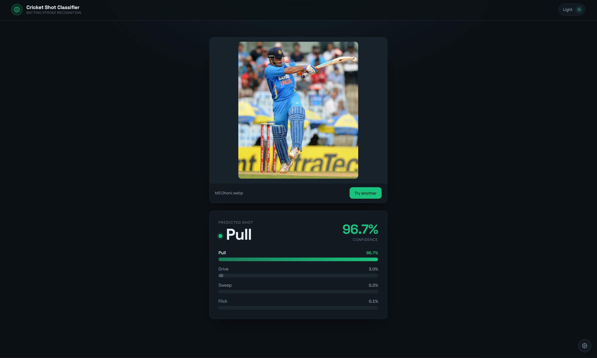
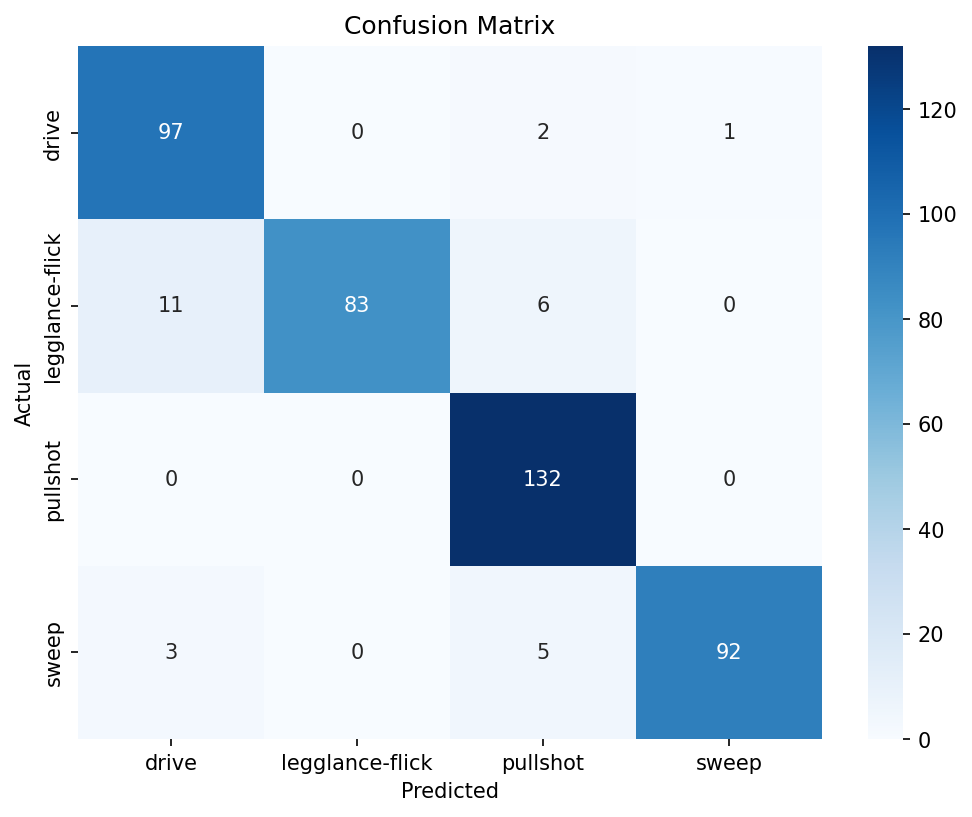

# 🏏 Cricket Shot Classifier

A deep learning-powered web app that identifies cricket batting shots from images using transfer learning — deployed as a full-stack application with FastAPI and a custom dark/light mode UI.

---
## 🌐 Live Demo

👉 **Try it here:**  
https://YOUR-RENDER-LINK-HERE.onrender.com

---
## 📸 Demo



---
## 🚀 Features

- 🧠 MobileNetV2 transfer learning (two-phase training)
- 🎯 94.21% test accuracy on unseen images
- 📊 Per-shot probability breakdown with confidence bars
- ⚡ FastAPI backend with single-load model serving
- 🎨 Dark/light mode responsive UI
- 🖼️ Drag-and-drop image upload with original resolution preview

---

## 🧠 How It Works

1. User uploads an image of a batsman mid-shot
2. Image is resized to 224x224 and passed to the model
3. Model (MobileNetV2 + custom head) outputs softmax probabilities
4. Top prediction + all class probabilities returned as JSON
5. UI renders the verdict with confidence visualization

**Classes:** Drive · Flick (Leg Glance) · Pull · Sweep

---

## 📊 Results

| Metric | Value |
|---|---|
| Test Accuracy | **94.21%** |
| Phase 1 (frozen base) | 83% val accuracy |
| Phase 2 (fine-tuned) | 95% val accuracy |
| Best Class | Pull (100% recall) |
| Hardest Class | Flick (83% recall) |

### Confusion Matrix


**Key insight:** Most errors are Flick→Drive and Sweep→Pull confusions — shot pairs that share similar body positions at the moment of contact.

---

## 🛠️ Tech Stack

- Python, TensorFlow/Keras
- MobileNetV2 (ImageNet pretrained)
- NumPy, Matplotlib, Seaborn, scikit-learn
- FastAPI + Uvicorn
- HTML/CSS/JS (custom UI)

---

## 📁 Project Structure
```
Cricket-Shot-Detector/
│
├── assets/
│   ├── demo.png
│   └── confusion_matrix.png
├── static/
│   ├── index.html
│   └── style.css
├── test/
├── preprocess.py
├── exploratory_data_analysis.py
├── model.py          
├── evaluate.py       
├── main.py           
├── app.py            
├── requirements.txt
└── README.md
```

---

## ⚙️ Model Architecture

- **Base:** MobileNetV2 pretrained on ImageNet (`include_top=False`)
- **Head:** GlobalAveragePooling → Dropout(0.3) → Dense(4, softmax)
- **Phase 1:** Frozen base, train head only — 10 epochs @ lr=1e-3 (5,124 trainable params)
- **Phase 2:** Unfreeze top 30% of base — 20 epochs @ lr=1e-5 (~800K trainable params)
- **Augmentation:** RandomFlip, Rotation, Zoom, Brightness, Contrast (in-graph)

---

## ⚠️ Challenges Faced (and Fixes)


### 1. Model Predicting Only One Class
**Problem:** Test evaluation showed everything classified as "sweep"

**Fix:** `shuffle=False` + alphabetical folder ordering meant test split contained only sweep images — enabled shuffle with fixed seed

### 2. Hardcoded Class Names Mismatch
**Problem:** Display names didn't match dataset folder names — wrong labels everywhere

**Fix:** Derived `CLASS_NAMES` from `train_ds.class_names` instead of hardcoding

### 3. Training Re-Running on Import
**Problem:** Importing from model.py triggered all 30 epochs

**Fix:** Moved training into `if __name__ == "__main__":` + save/load pattern

### 4. UI Probabilities Not Summing to 100
**Problem:** "Pull Shot" probability displayed as 0.0%

**Fix:** Space in display name broke frontend key mapping — renamed to "Pull"


---

## 🧭 Project Workflow

1. **Dataset** — Kaggle cricket shot images (4,723 images, 4 classes, near-balanced)
2. **EDA** — class counts, sample visualization, identified mixed crop/angle images
3. **Pipeline** — `image_dataset_from_directory` with 80/10/10 split
4. **Phase 1 Training** — frozen base, head-only (83% val)
5. **Phase 2 Fine-tuning** — top 30% unfrozen at low LR (95% val)
6. **Evaluation** — 94.21% test accuracy + confusion matrix analysis
7. **Inference** — save/load pattern, single-image prediction
8. **API** — FastAPI with file upload, JSON response
9. **UI** — built with Claude Design, dark/light mode
10. **Deployment** — Render with uvicorn

---

## 🚀 Deployment Notes
- Model file (23MB) committed directly — loads once at server start
- Free tier RAM constraints: tensorflow-cpu recommended

---

## 💡 Key Takeaway

```bash
Transfer Learning → Fine-Tuning → Evaluation → API → Full Web Application
```

---

## 💡 Final Note
This project demonstrates:

- Deep Learning (CNNs, transfer learning, fine-tuning)
- Model Evaluation (confusion matrix, per-class analysis)
- Backend Engineering (FastAPI, model serving)
- Frontend Development
- Deployment Readiness